# Corne + Prospector ZMK config

[ZMK](https://zmk.dev) firmware for a wireless 36-key Corne with nice!view
screens, plus a [Prospector](https://github.com/carrefinho/prospector)
display dongle as the central. The dongle runs a
[fork of the Prospector module](https://github.com/bakerbrandond/prospector-zmk-module)
with a Nord theme, status indicators, a clock set by the computer, a
matrix-rain screensaver and a small game. The halves show a night mountain scene where snow falls as you type.

<!-- Demo video: upload the .mp4 in a GitHub issue or comment box (don't submit
     it), then paste the resulting https://github.com/user-attachments/assets/…
     link on its own line here. -->

## Hardware

| Part | Board | Shields |
| --- | --- | --- |
| Left half | nice!nano v2 | `corne_left nice_view_adapter nice_view` |
| Right half | nice!nano v2 | `corne_right nice_view_adapter nice_view` |
| Dongle (central) | Seeed XIAO nRF52840 (`seeeduino_xiao_ble`) | `corne_dongle prospector_adapter raw_hid_adapter` |

The dongle has a 1.69" ST7789V screen (240×280, mounted landscape). Both halves
connect to the dongle and the dongle connects to the computer over USB or
Bluetooth. The Corne PCB is 42-key, but only 36 keys are fitted: the outer
columns are left empty (`___`) in the keymap.

Built on **ZMK v0.3** (see [`config/west.yml`](config/west.yml)).

## Keymap



The diagram is drawn by [keymap-drawer](https://github.com/caksoylar/keymap-drawer)
and redrawn by CI whenever the keymap changes (see [Keymap diagram](#keymap-diagram)).

- **Home-row mods** on both hands: Ctrl, GUI, Alt and Shift on A S D F and
  J K L ; (balanced hold-tap, 280 ms).
- **Lower** on the left thumb is a tap-dance. Hold it for Lower, tap then
  hold for Mouse, or triple-tap to toggle the Mouse layer on.
- **Function** is a tri-layer: hold Lower and Raise together.
- **Mouse**: move, click and scroll (with faster movement and scrolling than
  ZMK's defaults).
- **Function layer extras:**

  | Key | Does |
  | --- | --- |
  | D | Step the dongle's screen brightness (off, 5, 15, 30, 60, 100%; saved) |
  | F / J | Reset |
  | G / H | Bootloader |
  | K | Toggle the mouse jiggler |
  | L | Toggle output between USB and Bluetooth |
  | ; | Start Zappy Birds |
  | Z X C V B | Bluetooth profile 1–5 |
  | N | Clear the current Bluetooth profile |
  | M | Unlock ZMK Studio |

## Prospector dongle

Features from the [fork](https://github.com/bakerbrandond/prospector-zmk-module)
(main branch, for ZMK v0.3):

- **Nord colour theme**, with the active-layer roller, a battery bar for both
  halves (with an ✕ when a half isn't connected) and a WPM panel.
- **Indicators** (right side, CaskaydiaCove Nerd Font icons):
  - ZMK Studio unlocked (open lock)
  - mouse jiggler on (sleep-off)
  - USB output
  - Bluetooth output with the active profile number

  Each one is lit, dim or off to show its state.
- **Clock**: 24-hour `HH:MM` (or 12-hour) above the layer name, sent by the computer.
  It's hidden when no computer is sending the time (see [Clock](#clock)).
- **Brightness key** (Function + D). There's no ambient light sensor, so the
  backlight uses a fixed level, which the key steps through.
- **Matrix rain screensaver** after 2 minutes without a key press. Any key
  wakes it.
- **Zappy Birds**: a flappy-bird style game on the dongle.
  - Start it with Function + ;. Every key flaps and nothing is sent to the
    computer.
  - Press **H** on the title screen for hard mode: only the letter shown on
    screen flaps.
  - Best scores for both modes are saved.
  - Leave with **Q + P** together.
- **ZMK Studio** over the dongle's USB. Unlock it with Function + M.
- **Mouse jiggler** from [zmk-anti-idle](https://github.com/kbrd-space/zmk-anti-idle):
  every 30 s while it's on, the pointer moves down and back up.

## Clock

The dongle has no real-time clock, so a small app on the computer sends it the
time over Raw HID ([zmk-raw-hid](https://github.com/zzeneg/zmk-raw-hid), over
USB or Bluetooth). The app sends `[0xAA, hour, minute]` whenever the minute
changes, and the dongle counts on from the last update. If nothing arrives for
3 minutes (`CONFIG_PROSPECTOR_CLOCK_TIMEOUT_S`), the clock hides itself. That
happens when the app isn't running, or when the dongle is switched to a
computer without it.

**Linux:** [`scripts/hid-clock.py`](scripts/hid-clock.py) (Python standard
library only) finds the dongle and sends the time. It keeps looking for the
dongle while it's unplugged.

```sh
# let your user write to the dongle's HID nodes (once)
sudo cp scripts/70-zmk-raw-hid.rules /etc/udev/rules.d/
sudo udevadm control --reload && sudo udevadm trigger

# try it
scripts/hid-clock.py --once

# run it in the background at login (edit the path in the unit if the repo is elsewhere)
mkdir -p ~/.config/systemd/user && cp scripts/hid-clock.service ~/.config/systemd/user/
systemctl --user daemon-reload && systemctl --user enable --now hid-clock
```

Over Bluetooth, the script uses the dongle's Bluetooth HID node when USB isn't
connected. If the dongle was paired with the computer before the clock
firmware was first flashed, **remove and re-pair it**. Otherwise the computer
keeps its saved list of the dongle's services and never sees the clock's
channel (Linux behaved like this). If the Bluetooth link doesn't come back
after the dongle reboots while it's on USB, `bluetoothctl connect <address>`
reconnects it.

**macOS and Windows:** use [qmk-hid-host](https://github.com/zzeneg/qmk-hid-host),
which sends the same packet. Download it from its releases page and put this
`qmk-hid-host.json` next to it:

```json
{ "devices": [{ "productId": "0x615e" }] }
```

`0x615e` is ZMK's USB product ID. qmk-hid-host is written for QMK keyboards
and its macOS support is described as partial, so this setup is untested here.
It also sends volume and layout messages, which the dongle ignores.

Settings in [`config/corne_dongle.conf`](config/corne_dongle.conf):

| Setting | Effect |
| --- | --- |
| `CONFIG_PROSPECTOR_CLOCK_12H=y` | 12-hour time, e.g. `2:32 PM`, instead of `14:32` |
| `CONFIG_PROSPECTOR_CLOCK_TIMEOUT_S=180` | Seconds without an update before the clock hides |
| `CONFIG_PROSPECTOR_CLOCK=n` | No clock |

## nice!view halves

Each half shows the night mountain from ZMK's nice!view art: a black sky with
stars, a crescent moon and a white ridge line, stretched over the whole screen.

- **Light snow** falls all the time while the keyboard is active.
- **Each key press** drops a flake above that key's column.
- **Typing faster** adds more flakes anywhere, and more of them big.
- **Flakes pile into a drift** at the bottom of the frame. The drift melts back
  to a dusting 5 s after you stop typing.
- **When the keyboard goes idle** (30 s), the snow stops and the screen stays
  still until the next key press, so it doesn't drain the battery overnight.

This is [`src/nice_view_snow.c`](src/nice_view_snow.c). It wraps the stock
nice!view peripheral widget at link time and draws its own canvas over it.

The stock battery and connection icons are hidden because the dongle already
shows both. To bring them back as CaskaydiaCove icons (battery level and
percentage, plus a check or cross for the link to the central), set this in
[`config/corne_left.conf`](config/corne_left.conf) and/or
[`config/corne_right.conf`](config/corne_right.conf):

```
CONFIG_NICE_VIEW_SNOW_STATUS=y
```

Scene options (also in the `.conf` files):

| Setting | Scene |
| --- | --- |
| `CONFIG_NICE_VIEW_SNOW_SCENE_MOUNTAIN_NIGHT=y` | Night mountain (used on both halves) |
| `CONFIG_NICE_VIEW_SNOW_SCENE_MOUNTAIN=y` | Stock mountain with dithered sun rays |
| `CONFIG_NICE_VIEW_SNOW_SCENE_BALLOON=y` | Stock balloon on a night sky |

## Without a Prospector

The halves are built as peripherals of the dongle. To use them on their own:

1. Delete `CONFIG_ZMK_SPLIT_ROLE_CENTRAL=n` from
   [`config/corne_left.conf`](config/corne_left.conf), so the left half becomes
   the central again.
2. Remove the `corne_dongle` and `seeeduino_xiao_ble` entries from
   [`build.yaml`](build.yaml). You can also drop the `prospector-zmk-module`
   and `zmk-raw-hid` projects from [`config/west.yml`](config/west.yml).
3. Set `CONFIG_NICE_VIEW_SNOW_STATUS=y` in
   [`config/corne_right.conf`](config/corne_right.conf) if you want battery and
   connection icons on the right half.

The snow scene only runs on peripheral halves. The left (central) half shows
ZMK's own status screen with layer, battery and Bluetooth profile. The
dongle-only keys (screen brightness, Zappy Birds, Studio unlock) do nothing
without the dongle, and there's no clock.

## Building

### GitHub Actions

Every push builds all targets in [`build.yaml`](build.yaml). Download the
`firmware` artifact from the run and flash:

| File | Flash to |
| --- | --- |
| `corne_left nice_view_adapter nice_view-nice_nano_v2-zmk.uf2` | left half |
| `corne_right nice_view_adapter nice_view-nice_nano_v2-zmk.uf2` | right half |
| `corne_dongle prospector_adapter raw_hid_adapter-seeeduino_xiao_ble-zmk.uf2` | dongle |
| `settings_reset-*.uf2` | clears saved pairings (see below) |

To flash, double-tap reset to enter the bootloader, then copy the `.uf2` onto
the drive that appears (`NICENANO` for the halves, `XIAO-SENSE` for the
dongle).

If the halves won't pair with the dongle (for example after changing which
board is the central), flash `settings_reset` to all three boards, then flash
the real firmware again.

### Locally (Docker)

[`scripts/build-local.sh`](scripts/build-local.sh) builds in the
`zmkfirmware/zmk-build-arm:stable` image, using a local checkout of the
Prospector fork at `../prospector-zmk-module`. That way unpushed fork changes
can be tested.

```sh
scripts/build-local.sh dongle   # or left, right, all
# uf2 at ~/.cache/zmk-zappy-ws/out/<target>/zephyr/zmk.uf2
```

Extra arguments are passed to CMake, e.g.
`scripts/build-local.sh dongle -DCONFIG_PROSPECTOR_ZAPPY_BIRDS=n`.

### Keymap diagram

[`scripts/draw-keymap.sh`](scripts/draw-keymap.sh) parses the keymap with
keymap-drawer 0.23.0 (via `uv`). It then trims it to the 36 fitted keys with
[`scripts/keymap_36.py`](scripts/keymap_36.py) and writes
[`docs/keymap.svg`](docs/keymap.svg). The labels are set in
[`keymap_drawer.config.yaml`](keymap_drawer.config.yaml). The
[Draw keymap](.github/workflows/draw-keymap.yml) workflow runs it on every
keymap change and commits the result.

## Repository layout

| Path | What |
| --- | --- |
| `config/corne.keymap`, `config/behaviors.dtsi` | Keymap, home-row mods, tap-dance, dongle behaviours |
| `config/*.conf` | Per-board settings (shared, left, right, dongle) |
| `config/west.yml` | ZMK v0.3, the Prospector fork, zmk-anti-idle, zmk-raw-hid |
| `boards/shields/corne/` | The `corne_dongle` shield |
| `src/nice_view_snow.c` | Snow scene for the halves |
| `src/nice_view_status.c` | Optional battery/connection icons for the halves |
| `src/prospector_indicators.c` | Studio, jiggler, USB and Bluetooth indicators on the dongle |
| `src/prospector_clock.c`, `src/clock_core.h` | The dongle clock and its time logic |
| `src/reboot_on_fatal.c` | Dongle reboots instead of halting on a fatal error |
| `src/fonts/` | CaskaydiaCove glyphs converted with lv_font_conv |
| `scripts/` | Local build, keymap diagram, and the Linux clock sender (`hid-clock.py`, its systemd unit and udev rule) |
| `tests/clock/` | Host tests for the clock logic: `make -C tests/clock test` |
| `docs/superpowers/` | Design notes and implementation plans for the features above |
| `docs/experiments/` | Unfinished experiments kept as patches |

## Credits

- [ZMK](https://github.com/zmkfirmware/zmk) (MIT), including the nice!view art
  the snow scene is drawn on.
- [Prospector](https://github.com/carrefinho/prospector) and
  [prospector-zmk-module](https://github.com/carrefinho/prospector-zmk-module)
  by carrefinho.
- [zmk-anti-idle](https://github.com/kbrd-space/zmk-anti-idle) by kbrd-space.
- [zmk-raw-hid](https://github.com/zzeneg/zmk-raw-hid) and
  [qmk-hid-host](https://github.com/zzeneg/qmk-hid-host) by zzeneg.
- [keymap-drawer](https://github.com/caksoylar/keymap-drawer) by caksoylar.
- Icons from [CaskaydiaCove Nerd Font](https://www.nerdfonts.com): Material
  Design Icons (Apache 2.0), Font Awesome 4 (OFL 1.1) and Cascadia Code digits
  (OFL 1.1). See [`src/fonts/LICENSE-icons.md`](src/fonts/LICENSE-icons.md).
